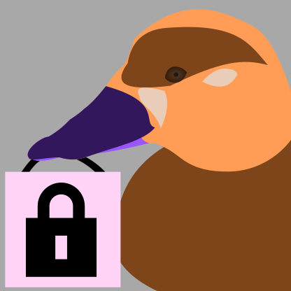

# surf-scoter-env

Secure environment for local development.



Developers need a way to run all their tooling, use their IDE of choice, and help prevent them from common security mistakes.  Due to pressure from malware and agents, the development environment increasingly needs to be treated like production from a cybersecurity perspective.  Additionally, with increasingly strict regulations and compliance requirements, we need ways to make sure we aren't putting ourselves in hot water.

Surf Scoter has you run your environment inside a container, using another container like a VPN to control network connectivity, and a small access module to enable limited external access to your host.

Surf Scoter has your back, but it can never prevent social engineering.  In the end, the weak point is you.


## Security Notes

These are the things you need to do to keep Surf Scoter's protections working.  The [security documentation](docs/security/README.md) explains the reasons behind each one.

### Review a project before you run it

If you plan on running the Surf Scoter dev-environment from a unknown source, you need to review the files that decide what its container can do.  They define how the container can communicate outside its sandbox, which means it can do things you're not ready for.

- **The project configuration file** (`.surf-scoter.d/project.yaml`) lists the commands the container may run on your host.  You can read details on do's and don'ts with this file in the [documentation](docs/project-configuration-file.md), and in [Running commands on the host](#running-commands-on-the-host).
- **The egress rules** (`egress` in `.surf-scoter.d/project.yaml`) say where the container may connect.
- **The dev container's `Dockerfile` and `dev-env.yaml`** build and run the container.  Look for multi-line values in `dev-env.yaml`, a final `USER` other than an unprivileged user, and downloads in `RUN` steps.

Review changes to these files whenever they come back from the workspace, too.  They change what the *next* environment may do.

### Don't run git or your IDE on the workspace from your host

Part of running Surf Scoter copies your project directory into a workspace directory.  This allows the dev container to make alterations to it without affecting your local copy.

While this helps keep a strong security setup, you need to bring those changes back into your local copy.  However, you need to take care here.  If an agent or malicious package modified the hooks in that directory, then running commands there could trigger them to run on your host computer.

For strongest safety, treat the workspace as untrusted from the host side:

- Use your IDE through its remote connection to the container, not by opening the workspace folder on the host.
- Bring changes back by fetching from the workspace into your own repository, then review them before merging or cherry-picking:

  ```sh
  cd ~/src/my-project
  git fetch /path/to/workspace/my-project my-branch
  git log -p HEAD..FETCH_HEAD
  ```

  Fetching reads the workspace repository's objects without running its hooks or configured commands.
- Review what you bring back as untrusted code, especially build scripts, before you build or run it on your host.
- Never run programs from the workspace on your host.
- If anything looks suspicious, start over from a fresh clone with `scoter run --clean-workspace`.
- Keep secrets out of the repository and out of the dev container's build context.  Use `vcs: git`, so your untracked files stay behind.

### Keep the network tight

- Keep the egress rules as short as the work permits.  Prefer exact hosts (`registry.npmjs.org`) to wildcards (`*.npmjs.org`).
- Keep your IDE's automatic port forwarding off (see [Connecting through VS Code](#connecting-through-vs-code)).
- Check the gateway log now and then (`podman logs HOSTNAME-ng`).  Denied requests show what the code in the container *tried* to reach.
- If you change the network settings, recheck every [required network property](docs/security/network.md#required-properties).  The [settings documentation](docs/security/settings.md) has a checklist.

### Protect your own computer

- Prefer a rootless container runtime.
- On a shared computer, keep your home directory at mode `0700` or `0750`.
- Treat everything inside the container, including your own IDE session there, as visible to the code it runs.

## Using Surf Scoter

Surf Scoter is still in early development stages.  At the moment, you'll need to download the project locally and make some updates for your local configuration.  Future work will aim to make this more turn-key.  Please add your experiences and customizations to the discussions!

### User Setup

To run Surf Scoter, you need to make some configuration settings to allow for an easier connection between your development container environment and your desktop.

You can perform the changes easily with the [`scoter`](scoter.py) script:

```shell
scoter user-setup
```

This will perform examine your environment, and ask you questions about how you want to proceed with updates.  At the moment, it:

- examines your user configuration files to see if they're valid.
- inspects your SSH directory (pulled from your settings) to see if files exist and whether they have the right permissions.

You only need to do this once.

### Starting a Developer Environment for a Project

If you're working with an established Surf Scoter project, and you've run through the above user setup, you should **first ensure it's safe to run.**  A project can declare [host-to-environment pass-through commands](#running-commands-on-the-host), which can lead to security issues.

Only then should you start the project environment by running:

```shell
scoter run
```

This will process the project files and start up containers.  It will report the launched process hostname, which you use to [connect to it with a shell or IDE](#connecting-to-a-developer-environment).

If you want to set up your project to define a Surf Scoter development environment, then [the fine documentation can help](docs/new-project-setup.md).

When a run ends, it stops its containers, but keeps the project's workspace for the next run.  If a run was stopped some other way, `scoter kill` stops what it left running, and `scoter cleanup` sweeps up what every stopped run, and every deleted project, left behind.  [Cleaning up after Surf Scoter](docs/cleaning-up.md) covers what's kept, and how to clear it out.

## Connecting to a Developer Environment

The following commands assume you use `podman`.  If you use `docker`, then switch the command execution to instead be `docker`.

When you launch the environment, scoter will tell you the container's hostname: `scoter-` and the project's id, such as `scoter-my-project-c593c7ec2d55`.  You use this as the connection ID.  Each running environment has its own entry in your `~/.ssh/config`; when it stops, scoter asks whether to remove it (see `ssh: values: config-cleanup` in [the setup file's documentation](docs/system-config-file.md)).

### Direct connect to the container

Connecting to the container is direct:

```shell
podman exec -it HOSTNAME /bin/bash
```

### Connect through SSH

Part of the `scoter` setup configures your user SSH so that you can just run.

Means you can run:

```shell
ssh HOSTNAME
```

without opening a port into the container.

This SSH capability allows you to take advantage of newer IDE features that allow for remote environments.

### Connecting through VS Code

With VS Code, you need to install Microsoft's [Remote - SSH](https://marketplace.visualstudio.com/items?itemName=ms-vscode-remote.remote-ssh) extension.  This allows the IDE to connect to the environment through SSH.

In order to make the IDE then perform its work in the sandbox, rather than continuing to run things on your host, make these changes in your user settings (`settings.json`):

- *Remote.SSH: Local Server Download*: set to "always" (`"remote.SSH.localServerDownload": "always"`)
    - Download the VS Code server on your computer and copy it into the container, since the container can't reach Microsoft's download servers.
- *Remote: Download Extensions Locally*: enable (`"remote.downloadExtensionsLocally": true`)
    - Download extensions on your computer and copy them into the container, for the same reason as above.
- *Remote: Auto Forward Ports*: disable (`"remote.autoForwardPorts": false`)
    - Don't automatically expose services running in the container on your computer.
    - To try out a server you're developing, use **Forward a Port** in the Ports view.  A forwarded port lets anything in the container serve content to your computer's `localhost`, so close it when you're done.

Once you have the developer environment running, you can then:

1. Run the palette command `Remote-SSH: Connect to Host...`.  It lists the hosts in your `~/.ssh/config`, where each running environment has its own entry, named after its project (such as `scoter-my-project-c593c7ec2d55`).
2. Choose the environment's host.

Some things to keep in mind:

- **Be careful with recommended extensions.**  The workspace can list extensions for VS Code to recommend (`.vscode/extensions.json`), and anything in the container can edit that list.  Some extensions run on your computer rather than in the container, so only install ones you'd install anyway.
- **Tasks and terminals run in the container.**  That's what keeps them contained, so don't work around it by opening the workspace folder on your computer (see [Security Notes](#security-notes)).

### Connecting through JetBrains

***TBD***

## Running commands on the host

Some actions need privileges the container deliberately doesn't have, such as cloud credentials or access to the Docker daemon.  For these, the container can ask the host to run a command for it.  The host only runs the exact command forms you list in its configuration file, and refuses everything else.

Because these commands run on your host with your privileges, every file they're given is restricted to the workspace (or a throwaway temporary directory).  A path argument is mapped from the container to the host and resolved, following symlinks, and it must still be inside the workspace.  The command's working directory follows the same rules.

Some suggestions for what to allow running on the host:

- **Only list commands that truly need the host's privileges.**  If a command works inside the container, run it there.  If it's something you can run on your host yourself, do that instead.  Every command you add is a way for whatever runs in the container, such as an agent or malware, to act on your host.
- **Put hard limits on files.** If you allow, say `docker compose up` with a file that the dev container can control, then you've opened yourself up to a root escape.  It's much safer to require the files to be ones the container can't edit.  This goes for commands like `make`, `npm run`, `terraform`, `docker build`, `bash`, and other ones that allow the caller to bypass your controls.  Never allow a command that reads code or configuration from a place the container can write.
- **Pin every argument you can.**  Write arguments as plain strings where possible.  Use `prefix` on `any` placeholders, and `allowed` patterns on `path` placeholders.
- **Pass the fewest environment variables you can.**  List credential names under `error`, so a request carrying them is refused.
- **Watch what host commands print.**  Their output lands in the container, so a command that prints a token hands it to the code you were keeping it from.


## "Surf Scoter"?

Yes, Surf Scoter.  That's not a typo.  It's a [large sea duck](https://en.wikipedia.org/wiki/Surf_scoter).

## License

[MIT](LICENSE)

